# Main experiment workflow

This page shows the procedure of the main experiment as one flowchart, from the source data to the final analysis. Each node gives the step and its key values. The table below the chart lists the decision document or report that records each step.

```mermaid
flowchart TD
    SRC["Source data: TalkMoves development file train_data_504.xlsx<br/>503 transcripts, 203,601 rows, 150,918 teacher rows"]
    ELIG["Eligible target population: teacher rows with utterance text<br/>N = 150,644 (274 teacher rows without text are ineligible as targets)"]
    DEV["Development targets D: 17 utterances<br/>2 per tag 0 to 6 by seeded draw, plus 3 boundary cases<br/>Used for tool validation and the procedural pilot"]

    subgraph PRE["Stages before the main experiment"]
        STATIC["Static checks on D before any API call<br/>check_inputs.py: 17 x 6 = 102 checks passed<br/>check_token_matching.py: 1,530 site checks, 0 mismatches"]
        VAL["Tool validation run validation-2026-09-23<br/>17 targets x 6 conditions x 3 repeats = 306 calls<br/>Scorer run on the output; kappa is diagnostic, no minimum kappa required"]
        PILOT["Procedural pilot run pilot-2026-09-24<br/>306 new calls on D; no agreement statistic computed<br/>Fixes operational settings: concurrency 4, timeout 60 s"]
        FREEZE["Protocol freeze, commit ed13ec2<br/>Decision documents fixed before the main sample is drawn"]
        STATIC --> VAL --> PILOT --> FREEZE
    end

    FRAME["Main sampling frame: eligible population minus D<br/>150,644 - 17 = 150,627<br/>D is excluded as targets only; D rows remain available as context"]
    SAMPLE["Main sample: simple random sampling without replacement<br/>n = 300, seed 20260924, scripts/build_main_sample.py<br/>The same 300 utterances are used in all 6 conditions"]

    CONTEXT["Context window for each target utterance<br/>7 preceding and 7 subsequent utterance rows, teacher and student rows both counted<br/>No padding at transcript boundaries; full utterance text, no truncation"]
    PROMPT["One user message per call, in this order:<br/>1 task instruction, 2 coding manual (omitted in names_only),<br/>3 context block with the target line marked [TARGET], 4 output instruction<br/>No human label appears in the prompt"]

    subgraph COND["6 prompt conditions, each applied to all 300 targets"]
        BASE["baseline<br/>Chapter 1 of the teacher coding manual, unmodified"]
        DEF["definition_replacement<br/>Replaces the 6 definition paragraphs, boundary statements included"]
        EXA["example_replacement<br/>Replaces the example items, the Examples headings,<br/>the S: and T: markers and the move labels inside examples"]
        EXC["exclusion_rule_replacement<br/>Replaces the 11 exclusion-rule items of section 1.6, inline examples included"]
        NEG["negative_control<br/>Replaces the theoretical background paragraph (3 sentences, judged task-irrelevant)"]
        NAMES["names_only: supplementary descriptive reference<br/>No manual section; category names appear only in the output instruction<br/>No filler, no token matching; excluded from the primary Delta kappa comparisons"]
    end

    PLACE["Placeholder in the 4 replacement conditions<br/>Space-separated percent signs, token count matched per site with o200k_base<br/>Sites per prompt: definition 6, example 72, exclusion rule 11, negative control 1<br/>Total prompt token count equal to baseline"]
    VERIFY["Input verification on the 300 main targets before any main-run call<br/>check_inputs.py: 300 targets x 6 conditions passed<br/>check_token_matching.py: 27,000 site checks, 0 mismatches"]

    API["Model and request, identical in all 6 conditions<br/>gpt-5.5-2026-04-23, Chat Completions, temperature 0, reasoning_effort none<br/>Strict JSON output: one field category, one of 7 category names"]
    CALLS["Repeated calls: 3 independent calls per utterance-condition pair<br/>Planned calls: 300 x 6 x 3 = 5,400<br/>One utterance per call; order shuffled in 3 blocks by repeat with recorded seeds"]
    AGG["Final label = the label with the largest count among valid repeats<br/>Requires at least 2 valid repeats"]
    TIE["Tie: 1 additional independent call, then recount<br/>At most 2 additional calls, so at most 5 repeats"]
    NOLBL["No final label when the tie remains after 5 repeats (unresolved tie)<br/>or when fewer than 2 repeats are valid (insufficient valid repeats)<br/>Never replaced by Not coded, never dropped silently"]
    RUN["Recorded main run main-2026-09-24<br/>Pass 1: 5,400 calls; pass 2: 1 tie-break call (names_only); pass 3 not needed<br/>Total 5,401 API calls; 1,800 final labels, all resolved"]

    KAPPA["Per condition: unweighted Cohen's kappa against the human labels<br/>Analysis n = 300 in every condition"]
    PAIRED["Each contrast is computed on the paired set:<br/>utterances with a resolved final label in both baseline and that condition"]
    DELTA["Primary estimand: Delta kappa = kappa_replacement - kappa_baseline<br/>3 substantive contrasts: definition, example, exclusion rule<br/>Negative-control Delta kappa reported alongside as context"]
    BOOT["Uncertainty: paired utterance-level bootstrap<br/>10,000 replicates, seed 20260919, two-sided 95 percent percentile intervals<br/>Human label and all condition labels of an utterance are resampled together"]
    NAMESREP["names_only: descriptive kappa and interval only<br/>No baseline-referenced contrast"]
    HELD["Out of scope: held-out evaluation on test_data_63.xlsx (63 transcripts) omitted<br/>Post-freeze decision made after main-run data collection and before scoring<br/>The held-out file received one structural check only; no model calls"]

    SRC --> ELIG --> DEV --> STATIC
    FREEZE --> FRAME --> SAMPLE --> CONTEXT --> PROMPT
    PROMPT --> BASE
    PROMPT --> DEF
    PROMPT --> EXA
    PROMPT --> EXC
    PROMPT --> NEG
    PROMPT --> NAMES
    DEF --> PLACE
    EXA --> PLACE
    EXC --> PLACE
    NEG --> PLACE
    BASE --> VERIFY
    NAMES --> VERIFY
    PLACE --> VERIFY
    VERIFY --> API --> CALLS --> AGG --> TIE --> RUN
    AGG -.-> NOLBL
    TIE -.-> NOLBL
    NOLBL -.-> RUN
    RUN --> KAPPA --> PAIRED --> DELTA --> BOOT
    KAPPA --> NAMESREP
    RUN -.-> HELD
```

Solid arrows show the order of the procedure. Dotted arrows show outcomes that occur only under a condition (no final label) or a decision recorded outside the main sequence (held-out omission). The six condition branches are different prompts for the same 300 utterances; they are not separate samples.

## Evidence

| Stage | Source file and section |
| --- | --- |
| Source data | `decisions/02-2-development-and-held-out-sets.md` §2.2.2; `decisions/02-1-dataset-selection-and-scope.md` §2.1.2 |
| Eligible target population | `decisions/02-1-dataset-selection-and-scope.md` §2.1.2 |
| Development targets D | `decisions/05-7-tool-validation.md` §5.7.2; `reports/tool-validation-record-2026-09-23.md` §3 |
| Static checks on D | `decisions/05-7-tool-validation.md` §5.7.1; `decisions/05-2-model-and-api-parameters.md` §5.2.4; `reports/tool-validation-record-2026-09-23.md` §4 |
| Tool validation run | `decisions/05-7-tool-validation.md` §5.7.1, §5.7.4; `reports/tool-validation-record-2026-09-23.md` §5, §6 |
| Procedural pilot | `decisions/05-5-role-of-the-pilot.md` §5.5; `decisions/05-6-execution-order-and-run-records.md` §5.6.4; `reports/procedural-pilot-record-2026-09-24.md` §1, §3, §5 |
| Protocol freeze | `reports/protocol-freeze-record-2026-09-24.md` §1, §2; `decisions/05-6-execution-order-and-run-records.md` §5.6.10 |
| Main sampling frame | `decisions/02-3-sampling-design.md` §2.3.2, revision note 2026-09-23; `decisions/05-7-tool-validation.md` §5.7.2 |
| Main sample | `decisions/02-3-sampling-design.md` §2.3.2, revision note 2026-09-24; `reports/main-sample-manifest-2026-09-24.json` |
| Context window | `decisions/05-1-context-specification.md` §5.1.1, §5.1.2, §5.1.3 |
| Prompt | `decisions/05-1-context-specification.md` §5.1.4, §5.1.6; `decisions/05-3-call-unit-and-api-request.md` §5.3.2, §5.3.3 |
| baseline | `decisions/03-1-manual-component-definition.md` §3.1.1, §3.1.7 |
| definition_replacement | `decisions/03-1-manual-component-definition.md` §3.1.2, §3.1.3, §3.1.7 |
| example_replacement | `decisions/03-1-manual-component-definition.md` §3.1.7, §3.1.8; `decisions/03-2-placeholder-specification.md` §3.2.2 |
| exclusion_rule_replacement | `decisions/03-1-manual-component-definition.md` §3.1.2, §3.1.3, §3.1.7 |
| negative_control | `decisions/03-1-manual-component-definition.md` §3.1.3, §3.1.6, §3.1.7 |
| names_only | `decisions/03-3-names-only-diagnostic.md` §3.3; `decisions/05-1-context-specification.md` §5.1.4 |
| Placeholder | `decisions/03-2-placeholder-specification.md` §3.2.2, §3.2.3; `reports/tool-validation-record-2026-09-23.md` §4 |
| Input verification on the main sample | `decisions/05-2-model-and-api-parameters.md` §5.2.4; `reports/input-verification-2026-09-24.md` §3, §4 |
| Model and request | `decisions/05-2-model-and-api-parameters.md` §5.2.1, §5.2.2; `decisions/05-3-call-unit-and-api-request.md` §5.3.1, §5.3.4, §5.3.5; `reports/protocol-freeze-record-2026-09-24.md` §3 |
| Repeated calls | `decisions/05-4-repetition-and-label-aggregation.md` §5.4.1; `decisions/05-3-call-unit-and-api-request.md` §5.3.10; `decisions/05-6-execution-order-and-run-records.md` §5.6.1 |
| Final label rule | `decisions/05-4-repetition-and-label-aggregation.md` §5.4.2, §5.4.8 |
| Tie handling | `decisions/05-4-repetition-and-label-aggregation.md` §5.4.3 |
| No final label | `decisions/05-4-repetition-and-label-aggregation.md` §5.4.3, §5.4.8 |
| Recorded main run | `reports/main-run-record-2026-09-24.md` §4, §5, §6; `reports/completeness-report-2026-09-24.md` §7 |
| Agreement per condition | `decisions/06-analysis.md` §6.1.1; `decisions/02-3-sampling-design.md` §2.3.2; `reports/main-scoring-record-2026-09-24.md` §8 |
| Paired set | `decisions/06-analysis.md` §6.1.2 |
| Primary estimand | `decisions/06-analysis.md` §6.1.2, §6.5; `decisions/03-1-manual-component-definition.md` §3.1.7; `decisions/02-3-sampling-design.md` §2.3.1 |
| Uncertainty | `decisions/06-analysis.md` §6.2.1, §6.3; `decisions/02-3-sampling-design.md` §2.3.7 |
| names_only reporting | `decisions/03-3-names-only-diagnostic.md` §3.3; `decisions/06-analysis.md` §6.5 |
| Held-out evaluation | `decisions/02-2-development-and-held-out-sets.md` §2.2.2, §2.2.3, revision note 2026-09-24; `reports/heldout-evaluation-decision-2026-09-24.md`; `reports/protocol-freeze-record-2026-09-24.md`, section "Post-freeze deviation: held-out evaluation omitted" |
